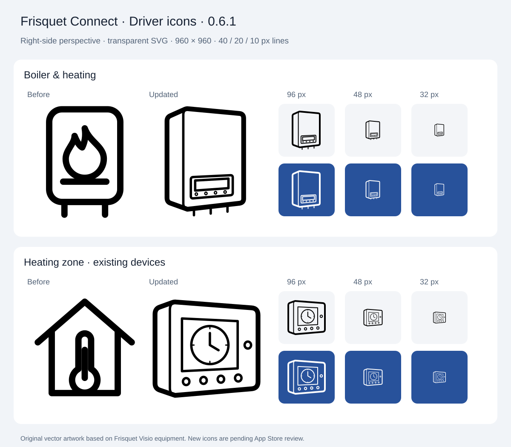

# Driver icons

Version 0.6.1 addresses the App Store review feedback about front-facing icons.
The replacement SVGs are original project artwork:

- `drivers/boiler/assets/icon.svg`: a Visio boiler enclosure, with its lower
  control panel and heating/hot-water connections.
- `drivers/zone/assets/icon.svg`: a Visio radio satellite, with its circular
  programme display, side mode key and four lower keys. This driver remains
  available for existing paired zones.

Both use the right-side angle illustrated in [Homey's driver-icon guidelines](https://apps.developer.homey.app/app-store/guidelines#id-1.6.-driver-icons),
with visible casing depth and perspective on the front-panel details. Each has
a 960 × 960 canvas, a transparent background, black line work, 40 px outlines,
20 px details and 10 px minor details. There are no fonts, raster images, filled
faces or gradients. The tall boiler fills the canvas vertically; the wider
satellite fills it horizontally without distorting the enclosure.

Drawing references are Frisquet's [Hydromotrix Condensation Visio product page](https://www.frisquet.com/fr/chaudiere-gaz-condensation-hydromotrix-25-32-kw_61.html)
and [Visio multizone presentation](https://www.frisquet.com/fr/innovations_11.html?innov=31).
The SVGs simplify the devices for recognition at small sizes and do not embed
the manufacturer's photographs.

Rendered review copies were inspected at 480, 96, 48 and 32 px, in black on white
and white on the app's `#28529B` brand colour. The preview is generated from the
actual driver SVGs; background tiles belong only to the preview. The installed
icons retain their transparency.



For a quick local rendering with librsvg:

```sh
rsvg-convert -b white -w 480 -h 480 drivers/boiler/assets/icon.svg -o /tmp/frisquet-boiler.png
rsvg-convert -b white -w 480 -h 480 drivers/zone/assets/icon.svg -o /tmp/frisquet-zone.png
```

Homey's schema validation cannot assess artistic compliance. The replacement
icons still need to be reviewed by Athom with the next submission.
